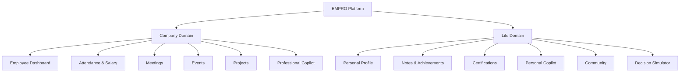
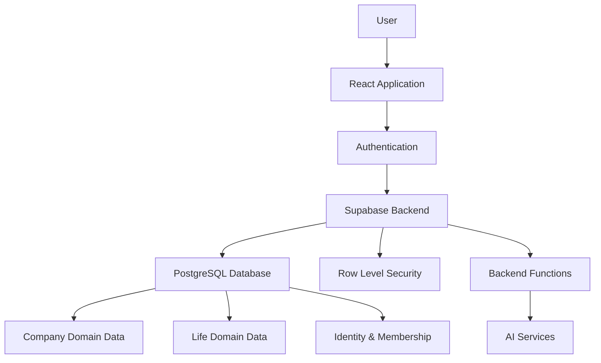
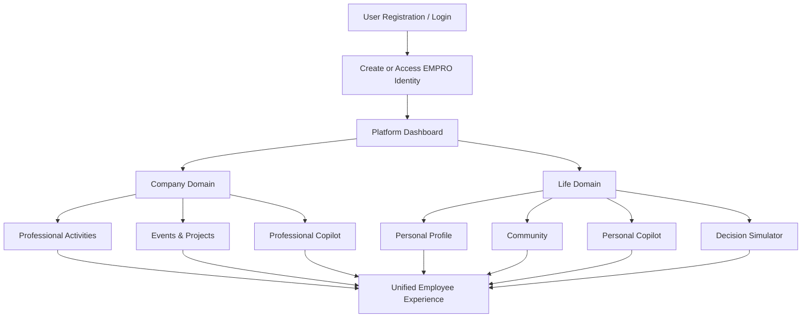

# EMPRO — Your Work. Your World. Your Identity.

<p align="center">
  <strong>A Unified Employee Identity & Intelligent Decision Platform</strong>
</p>

<p align="center">
  Connecting professional growth, workplace collaboration, personal development, and intelligent decision-making in one platform.
</p>

---

## 🚀 Overview

**EMPRO (Employee Profile)** is an intelligent employee-centric platform designed to bring an individual's professional and personal journey into one connected digital ecosystem.

Traditional workplace systems manage employees as company-specific records. Personal productivity applications separately manage an individual's life, goals, and decisions.

EMPRO aims to bridge this gap.

It introduces a unified digital identity where an individual can manage their professional activities, participate in company initiatives, explore opportunities, and make informed decisions — without losing their identity when moving between organizations.

The platform is built around two interconnected domains:

- **Company Domain** — Everything related to an individual's professional environment.
- **Life Domain** — Everything related to an individual's personal identity, development, and decisions.

---

## 🎯 Problem Statements

### 1. Fragmented Employee Experience

Employees interact with multiple disconnected workplace applications for attendance, salary information, meetings, projects, and company communication.

This creates fragmented information, disconnected workflows, and limited visibility into an employee's overall professional journey.

### 2. Limited Decision Support and Personal Development

Employees often lack structured systems to evaluate opportunities, assess the feasibility of their ideas, understand their capabilities, and make informed professional or personal decisions.

Most platforms manage existing information rather than helping individuals think through what they should do next.

## 💡 Our Solution

EMPRO introduces a unified employee ecosystem with:

- A continuous digital employee identity.
- Separate but connected Company and Life domains.
- Collaborative company events and project participation.
- AI-assisted decision simulation.
- Cross-company community interaction.
- Context-aware personal assistance.
- Privacy-controlled information sharing.

---

## 🏗️ Platform Architecture

EMPRO is organized into two major domains.



### 1. Company Domain

A dedicated professional workspace that connects employees with their organization and its activities.

**Core Modules**

| Module | Purpose |
|---|---|
| Dashboard | Overview of professional activities |
| Attendance | Attendance records and tracking |
| Salary Vault | Access to salary-related information |
| Meetings | Meeting information and coordination |
| Professional Copilot | AI assistance for professional workflows |
| Events | Company events and employee participation |
| Projects | Project collaboration and contribution tracking |

#### Events — Beyond Company Announcements

The Events module transforms ordinary company announcements into interactive participation opportunities.

Key capabilities:

- Company event announcements.
- Employee registrations.
- Contribution requests.
- Organizer approval workflows.
- Verified event check-ins.

#### Projects — Contribution Intelligence

The Projects module connects employees with meaningful project opportunities.

Key capabilities:

- Project overviews and team information.
- Open contribution opportunities.
- AI-assisted employee invitations.
- Manager-assigned responsibilities.
- Contribution history and participation tracking.

The objective is to make employee contributions more visible and create opportunities for collaboration beyond routine responsibilities.

---

### 2. Life Domain

A personal space that remains connected to the individual's identity, independent of their current organization.

**Core Modules**

| Module | Purpose |
|---|---|
| Personal Profile | Individual identity and professional information |
| Notes | Personal information and knowledge organization |
| Achievements | Record of individual accomplishments |
| Certifications | Professional learning credentials |
| Personal Copilot | Context-aware personal AI assistance |
| Community | Cross-company networking and interaction |
| Decision Simulator | AI-assisted decision evaluation |

#### Decision Simulator — Think Before You Decide

One of EMPRO's central differentiators.

The Decision Simulator helps individuals evaluate decisions before committing to them.

It supports both professional and personal decision scenarios.

**How it works:**

1. **Define the Problem:** Describe the decision or challenge.
2. **Provide an Approach:** Enter the proposed solution or possible direction.
3. **AI Analysis:** Evaluate feasibility, required skills, resources, and potential risks.
4. **Scenario Comparison:** Explore and compare possible approaches.
5. **Final Report:** Generate a structured decision analysis.
6. **Saved History:** Revisit previous simulations and evaluations.

Instead of simply storing information, EMPRO helps users evaluate possibilities.

---

## 🤖 AI Capabilities

Artificial intelligence is integrated into EMPRO to support meaningful interactions rather than functioning as a standalone chatbot.

| AI Component | Function |
|---|---|
| Professional Copilot | Contextual professional assistance |
| Personal Copilot | Assistance using approved personal context |
| AI Project Invitations | Helps identify suitable project contributors |
| Decision Simulator | Evaluates feasibility, skills, resources, and risks |

**Privacy principle:** The Personal Copilot operates using approved personal context, not confidential company records.

---

## 🌐 Cross-Company Identity & Community

One of EMPRO's foundational concepts is that an individual's identity should not be limited to their current employer.

The platform follows a continuous identity model:

- An individual maintains a persistent EMPRO identity.
- One active company membership is supported at a time.
- Previous company memberships can be archived as employment history.
- Community interaction can extend across different organizations.
- Personal information remains separate from company-owned information.

This creates a professional identity that continues throughout an individual's career.

---

## 🔐 Privacy & Access Control

EMPRO is designed around controlled information sharing.

Four visibility levels are defined:

| Visibility | Access |
|---|---|
| Private | Only the owner |
| Selected Connections | Specifically authorized connections |
| Company | Authorized members of the organization |
| Public | Publicly accessible information |

Access permissions must be enforced at the backend level rather than relying only on frontend visibility settings.

The platform also follows a separation principle between personal and company information.

---

## 🛠️ Technology Stack

The application follows a modern web application architecture.

| Technology | Purpose |
|---|---|
| React | Component-based user interface |
| Vite | Development server and build tooling |
| TypeScript | Type-safe application development |
| Supabase | Backend platform |
| PostgreSQL | Relational database |
| Supabase Auth | User authentication |
| Row Level Security (RLS) | Database-level access control |
| AI Integration | Intelligent assistance and decision analysis |
| Git & GitHub | Version control and source management |

*The exact AI provider and deployment configuration should be documented alongside the implementation.*

---

## 🗄️ Backend Architecture

EMPRO uses a structured backend architecture to manage user identity, company relationships, professional activities, personal information, and AI-assisted workflows.



### Key Backend Responsibilities

- User authentication and session management.
- Employee identity management.
- Company membership management.
- Professional and personal data separation.
- Event registration and approval.
- Project participation and contribution tracking.
- Decision simulation history.
- Backend-enforced visibility and access permissions.

---

## 🔄 Application Workflow



---

## 🌟 What Makes EMPRO Different?

| Traditional Platforms | EMPRO |
|---|---|
| Company-specific employee records | Continuous individual identity |
| Separate workplace and personal tools | Two connected domains |
| Static company announcements | Interactive Events |
| Basic project assignment | Contribution Intelligence |
| Generic AI chatbots | Context-aware AI assistance |
| Information storage | AI-assisted decision simulation |
| Organization-specific networking | Cross-company community |

EMPRO shifts the focus from merely managing employees to empowering individuals.

---

## 🎯 Vision & Future Scope

EMPRO aims to evolve into a unified digital ecosystem for an individual's professional and personal journey.

Potential future directions include:

- Advanced AI-driven employee insights.
- Intelligent project and talent matching.
- Expanded decision intelligence.
- Deeper professional networking.
- Personalized development recommendations.
- Advanced analytics and reporting.
- Expanded integrations with organizational systems.

---

## 💻 Getting Started

### Prerequisites

- Node.js
- npm
- Git
- Supabase project credentials

### Installation

**1. Clone the repository**

```bash
git clone <YOUR_GITHUB_REPOSITORY_URL>
```

**2. Navigate to the project**

```bash
cd EMPRO
```

**3. Install dependencies**

```bash
npm install
```

**4. Configure environment variables**

Create a local environment file using the variable names required by the application.

Add your Supabase project URL, public client key, and other required configuration.

Never commit private API keys, service-role keys, or secrets to GitHub.

**5. Start the development server**

```bash
npm run dev
```

Open the local development URL displayed in your terminal.

---

## 📁 Project Structure

The application follows a modular architecture.

```text
EMPRO/
│
├── public/
│
├── src/
│   ├── components/
│   ├── pages/
│   ├── layouts/
│   ├── hooks/
│   ├── services/
│   ├── integrations/
│   ├── types/
│   └── utils/
│
├── supabase/
│   ├── migrations/
│   └── functions/
│
├── .env.local
├── .gitignore
├── package.json
├── tsconfig.json
├── vite.config.ts
└── README.md
```

*Illustrative structure; align the directory names with the actual repository before publishing.*

---

## 👥 Target Users

- Employees seeking a unified professional identity.
- Organizations looking to improve employee participation.
- Project managers seeking better contribution visibility.
- Professionals interested in continuous development.
- Individuals who want structured assistance with important decisions.

---

## 🏁 Conclusion

**EMPRO is more than an employee management application.**

It is an attempt to rethink how individuals interact with their professional environments while maintaining ownership of their personal identity.

By connecting workplace collaboration, personal development, cross-company networking, and AI-powered decision support, EMPRO creates a unified ecosystem centered around the individual.

<p align="center">
  <strong>Your Work. Your World. Your Identity.</strong>
</p>

<p align="center">
  Built with the vision of making every individual's professional and personal journey more connected, intelligent, and meaningful.
</p>

---

*Project: EMPRO — Employee Profile*  
*Category: AI-Powered Employee Ecosystem & Decision Intelligence Platform*
