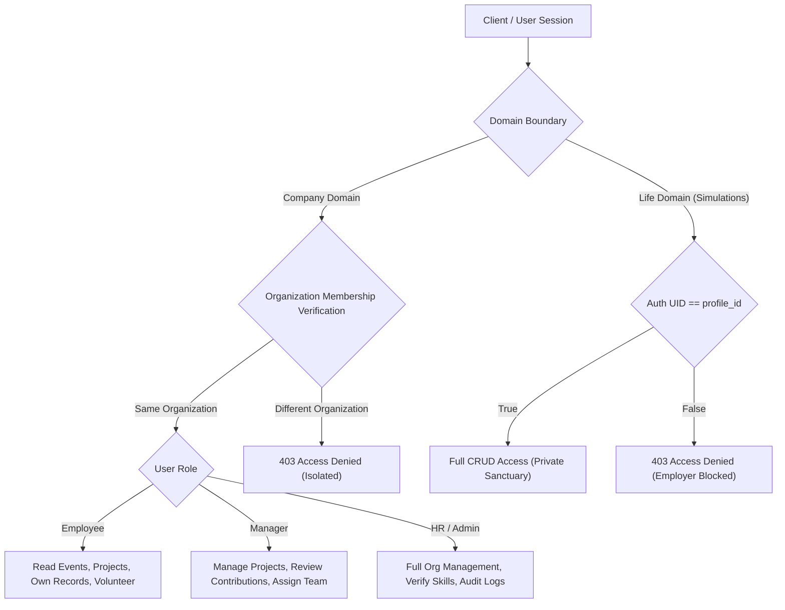

# EMPRO — Supabase Database Migration & Deployment Guide

This guide provides the complete, production-ready blueprint for deploying EMPRO's database schema, Row-Level Security (RLS) policies, database triggers, and environment configuration to your Supabase project.

---

## 1. Migration Execution Plan & File Sequence

Execute the following SQL migration files in exact numerical order via the **Supabase Dashboard -> SQL Editor** or via the Supabase CLI (`supabase db push` / `supabase migration up`).

| Order | Migration File | Scope & Capabilities |
|---|---|---|
| **01** | `20261121000001_core_database_foundation.sql` | Core user identity (`profiles`), organizations (`organizations`), departments, designations, and organization membership (`organization_members`). Auto-creates profiles on `auth.users` sign-up via `public.handle_new_user()`. |
| **02** | `20261121000002_domain_modules_schema.sql` | Timesheets (`attendance_records`), compensation (`salary_structures`, `payslips`), calendar sync (`meetings`, `meeting_attendees`), portable credentials (`achievements`), and community feed (`community_posts`, `community_comments`). |
| **03** | `20261122000001_collaboration_intelligence_schema.sql` | Company events (`events`, `event_registrations`, `event_contributions`, `event_attendance`), projects (`projects`, `project_members`, `project_contributions`), and AI Decision Simulator (`decision_simulations`). |
| **04** | `20261122000002_skills_availability_schema.sql` | Verified technical skills (`employee_skills`) and declared bandwidth allocation (`employee_availability`) for the AI Contribution Discovery engine. |
| **05** | `20261122000003_functions_triggers_integrity.sql` | Cross-organization boundary validation, event deadline enforcement, capacity limits, automated daily attendance synchronization, and contribution review tracking triggers. |

---

## 2. Table Classification: Reused vs. New Tables

### A. Existing Tables Reused Without Breaking Modifications
These tables were established during the initial database foundation and domain phases and are preserved intact:
1. `profiles` — User identity synced to `auth.users`.
2. `organizations` — Multi-tenant company entities.
3. `departments` — Organization subdivisions.
4. `designations` — Organization job titles.
5. `organization_members` — User-to-company link with roles (`employee`, `manager`, `hr`, `admin`).
6. `attendance_records` — Daily timesheets and check-in records.
7. `salary_structures` & `payslips` — Immutable payroll records.
8. `meetings` & `meeting_attendees` — Team syncs and RSVP statuses.
9. `achievements` — 4-tier visibility career milestone records.
10. `community_posts` & `community_comments` — Cross-company professional network.
11. `leave_types`, `leave_balances`, `leave_requests`, `corporate_documents`, `diary_entries`, `life_goals` — Preserved legacy tables.

### B. New Tables Required for Collaboration & Intelligence Transformation
1. `events` — Company gatherings, hackathons, workshops, and celebrations.
2. `event_registrations` — Track attendee registrations with deadline checks.
3. `event_contributions` — Volunteer assistance requests and organizer review approvals.
4. `event_attendance` — Verified event check-in records separate from registration.
5. `projects` — Strategic initiatives, milestones, and open contribution requisitions.
6. `project_members` — Team assignments with allocation percentages.
7. `project_contributions` — Tracks 3 contribution modes (Open, AI-Recommended, Manager-Assigned).
8. `decision_simulations` — Privacy-isolated AI simulation reports and scenario comparisons.
9. `employee_skills` — Verified skills inventory with proficiency ratings and audit trail.
10. `employee_availability` — Declared contribution bandwidth and workload telemetry.

---

## 3. Row-Level Security (RLS) Policy Architecture

All 29 tables have RLS enabled (`ALTER TABLE ... ENABLE ROW LEVEL SECURITY;`).



### Policy Summary Table

| Domain / Scope | Tables | Policies Enforced |
|---|---|---|
| **User & Org** | `profiles`, `organizations`, `organization_members` | Profiles: Read public, update own. Members: Read own company colleagues. |
| **Events** | `events`, `event_registrations`, `event_contributions`, `event_attendance` | View: Any member of the host organization. Manage/Approve: Event organizer, Manager, HR, Admin. Register/Volunteer: Self member only. |
| **Projects** | `projects`, `project_members`, `project_contributions` | View: Members of the project's company. Manage/Assign: Project Manager, Managers, Admins. Volunteer: Self member only. |
| **Skills & Bandwidth** | `employee_skills`, `employee_availability` | View: Company colleagues. Edit: Own skills and availability. Verify: Managers, HR, Admin. |
| **Timesheets & Payroll** | `attendance_records`, `payslips` | View: Employee reads own records; Managers/HR view subordinates. |
| **Decision Simulator** | `decision_simulations` | Strictly individual: `profile_id = auth.uid()`. Company managers cannot view. |

---

## 4. Database Functions & Automated Triggers

The following business logic functions operate directly in PostgreSQL:

1. **`public.handle_new_user()`**:
   - Triggers `AFTER INSERT ON auth.users`.
   - Automatically provisions a matching record in `public.profiles`.
2. **`public.validate_event_registration()`**:
   - Triggers `BEFORE INSERT ON public.event_registrations`.
   - Throws an exception if `now() > registration_deadline` or if `current_attendees >= max_attendees`.
3. **`public.handle_event_attendance_sync()`**:
   - Triggers `AFTER INSERT OR UPDATE ON public.event_attendance`.
   - Automatically upserts a verified check-in to `public.attendance_records` for the event date.
4. **`public.handle_event_contribution_status_change()`**:
   - Triggers `BEFORE UPDATE ON public.event_contributions`.
   - Automatically timestamps `reviewed_at = now()` when a request is approved or rejected.
5. **`public.validate_project_member_organization()`**:
   - Triggers `BEFORE INSERT OR UPDATE ON public.project_members`.
   - Prevents assigning an employee from Company A to a project belonging to Company B.
6. **`public.validate_project_contribution_organization()`**:
   - Triggers `BEFORE INSERT OR UPDATE ON public.project_contributions`.
   - Enforces cross-organization isolation for voluntary and assigned project contributions.

---

## 5. Required Environment Variables

Configure these in your production hosting environment (e.g., Vercel, Netlify, Cloudflare Pages) and in the root `.env` for local testing:

| Variable Name | Description | Example / Format |
|---|---|---|
| `VITE_SUPABASE_URL` | The REST API URL of your Supabase project. | `https://[PROJECT-REF].supabase.co` |
| `VITE_SUPABASE_PUBLISHABLE_KEY` | The anon/publishable key for client requests. | `eyJhbGciOiJIUzI1NiIsInR5cCI6IkpXVCJ9...` |

> [!IMPORTANT]
> Never configure `SUPABASE_SERVICE_ROLE_KEY` in frontend `.env` files. The EMPRO frontend is client-side React + Vite and communicates exclusively through authenticated user sessions and publishable keys.

---

## 6. Supabase Dashboard Configuration Checklist

Before launching to users, verify the following settings in your **Supabase Project Dashboard**:

### A. Authentication Settings (`Authentication -> Providers -> Email`)
- **Enable Email Provider**: Ensure the Email provider is **Enabled**.
- **Confirm Email**:
  - *Development / Testing*: Toggle **Confirm email** to `OFF` for instant sign-ins.
  - *Production*: Toggle **Confirm email** to `ON` and customize email templates.
- **Minimum Password Length**: Set to at least 6 (recommended: 8+).

### B. URL Configuration (`Authentication -> URL Configuration`)
- **Site URL**: Enter your production web application domain (e.g. `https://empro.app` or `http://localhost:5173` for development).
- **Redirect URLs**: Add `https://empro.app/**` and `http://localhost:5173/**` to allow Auth redirects.

### C. API Settings (`Project Settings -> API`)
- Confirm that the `public` schema is exposed in the API settings.

---

## 7. Step-by-Step Deployment Verification

1. **Open Supabase SQL Editor**:
   Navigate to `https://supabase.com/dashboard/project/[YOUR-PROJECT-ID]/sql`.
2. **Run Migrations in Order**:
   Paste and execute each file:
   - `01`: `20261121000001_core_database_foundation.sql`
   - `02`: `20261121000002_domain_modules_schema.sql`
   - `03`: `20261122000001_collaboration_intelligence_schema.sql`
   - `04`: `20261122000002_skills_availability_schema.sql`
   - `05`: `20261122000003_functions_triggers_integrity.sql`
3. **Configure `.env`**:
   Update `VITE_SUPABASE_URL` and `VITE_SUPABASE_PUBLISHABLE_KEY` in `.env`.
4. **Test Communication**:
   Open the application and click **"Supabase" -> "Verify"** in the top navigation bar to confirm live REST communication.
5. **Run Integration Test Suite**:
   ```bash
   node scripts/test-backend-integration.mjs
   ```
   Confirm all 107 tests pass.
